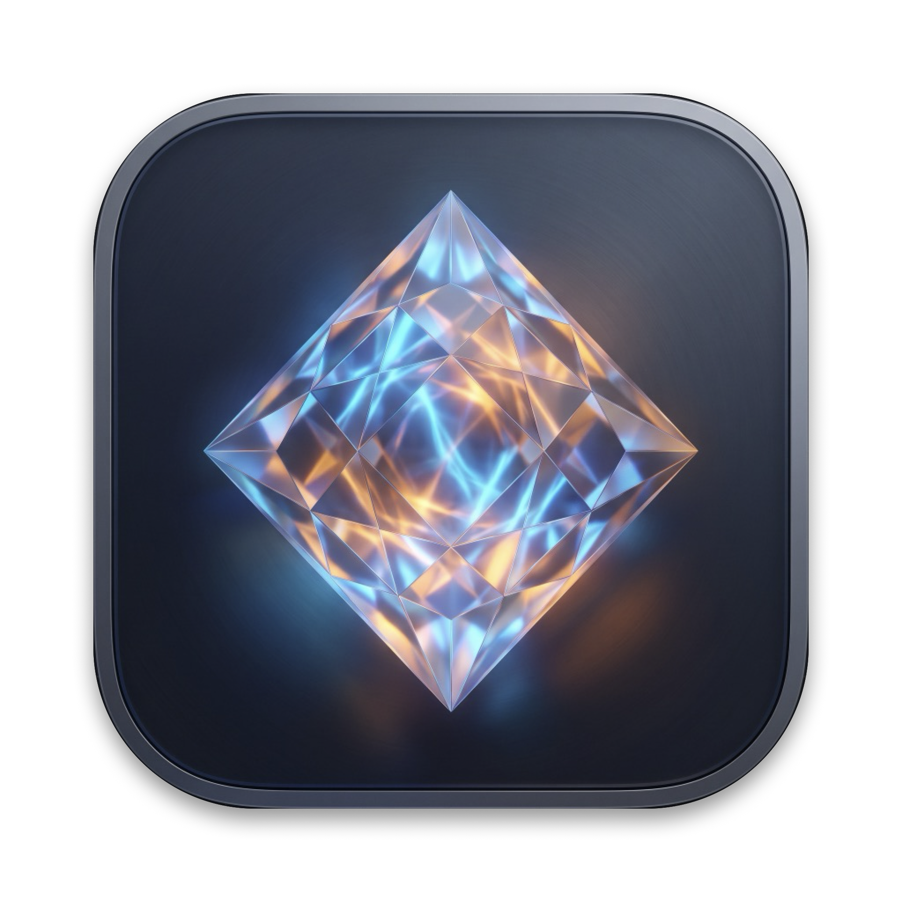
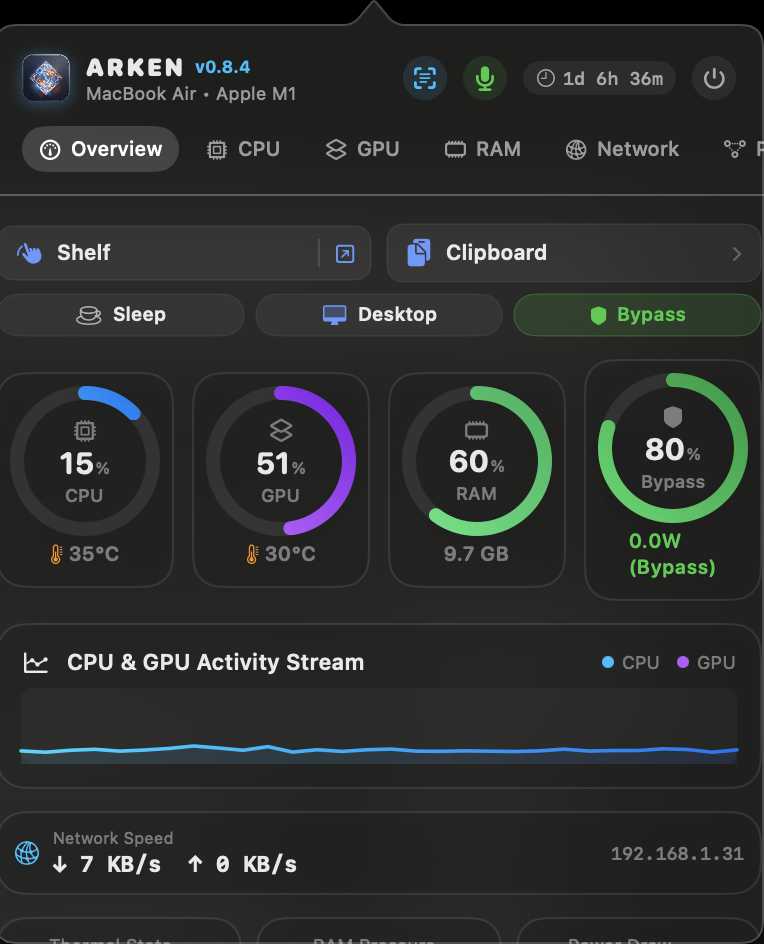
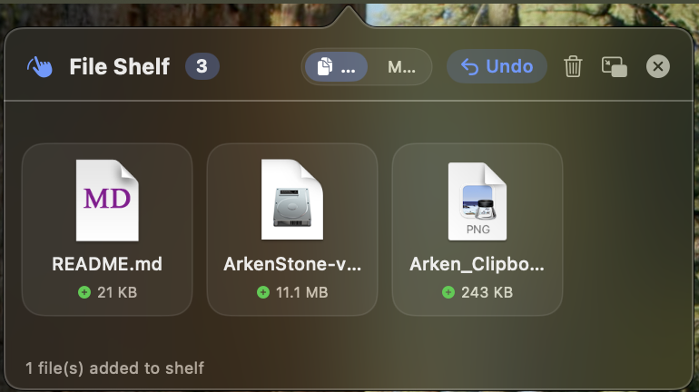
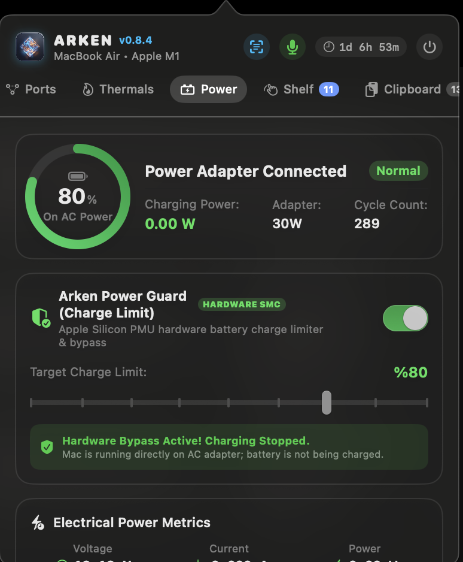
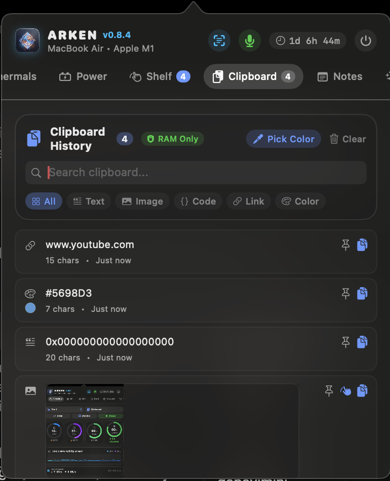
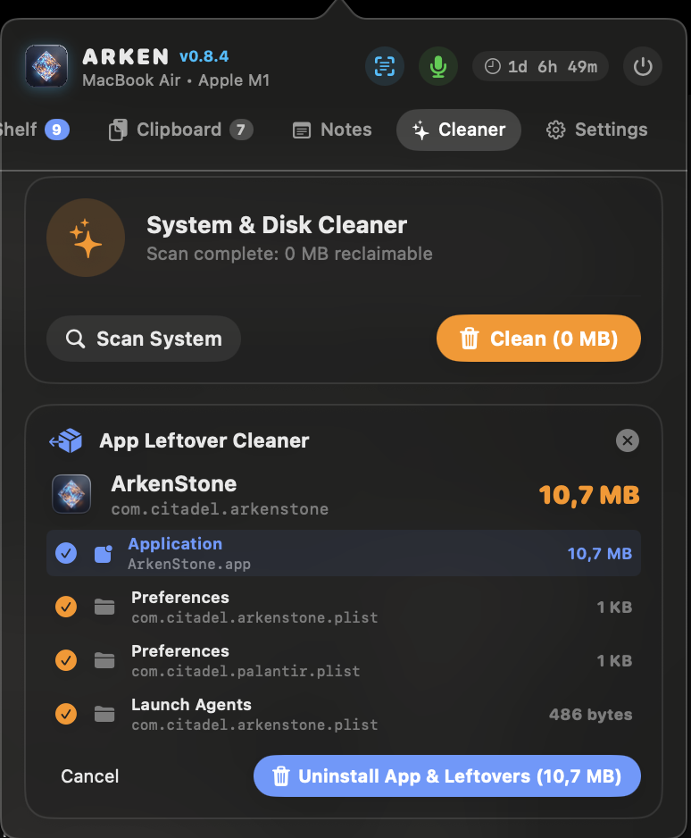

<div align="center">



# 💎 ArkenStone (Arken)

### *The Featherlight, All-in-One macOS System Monitor, Power Guard & Productivity Suite*

[](https://apple.com)
[-orange?style=for-the-badge&logo=apple)](https://apple.com)
[](https://swift.org)
[-brightgreen?style=for-the-badge)]()
[-blue?style=for-the-badge)]()
[](LICENSE)

<br/>

### [ 🍏 Download Ready-to-Run DMG ($5 Lifetime Access on Whop) ](https://whop.com/github-03d6/arkenstone-lifetime-access/) &nbsp;&nbsp;•&nbsp;&nbsp; [ 🛠️ Build from Source (100% Free) ](#-two-ways-to-get-arkenstone)

*Get instant pre-compiled `.dmg` downloads, lifetime updates, and directly support independent software development — or clone and build it yourself from source for free.*

</div>

---

## 🧭 The Vision & Non-Negotiable Core Principle

Mac users today suffer from **menu bar bloat** and **subscription fatigue**. To get essential system metrics, keep battery healthy at 80%, stage temporary files, clean orphaned caches, and copy locked text from the screen, you are forced to run 5 to 8 separate utilities. Most of these apps are bloated Electron wrappers consuming 400 MB+ of RAM each, or charging monthly subscriptions for simple features.

**ArkenStone was built with a single, non-negotiable rule:**
> **Maximum everyday utility with the absolute minimum system footprint.**
> 
> ArkenStone fuses 10+ essential utilities into a single, pure native Swift and C menu bar app that idles at **~42 MB of RAM** and **< 0.2% CPU**. Every feature added now and in the future must strictly honor this zero-bloat, featherlight standard.

---

## 📸 Visual Overview

<div align="center">

### 1. Overview Dashboard & 2-Tier Glass Control Center


<br/><br/>

### 2. Detachable Drop Shelf & Multi-Window Floating Workspace


<br/><br/>

### 3. Hardware Power Guard & Motherboard SMC Battery Bypass


<br/><br/>

### 4. Smart RAM-Only Clipboard History & Color Pipette


<br/><br/>

### 5. App Leftover Cleaner & Deep Uninstaller


</div>

---

## ⚡ 10+ Essential Utilities: Full Guide & Real-World Scenarios

### 1. 🛡️ Hardware Power Guard & Clamshell Awake
* **What it does:** Communicates directly with the Apple Silicon SMC (System Management Controller) via a lightweight C helper (`arken-power-helper`) to stop battery charging at your target limit (e.g. 80%) while running your Mac directly on AC power.
* **⚡ Top-Up to 100% Mode (v0.8.5):** Single-click temporary bypass to fill the battery to 100% before travel or meetings. Automatically re-engages normal 80% protection the moment the battery reaches 100% or the power brick is disconnected.
* **Clamshell Mode:** Keeps your MacBook awake with the lid closed even without an external monitor or mouse connected.
* **Clamshell Authorization Guard (v0.8.6):** Gracefully halts repeated password prompts if canceled; provides a 1-click retry pill and status indicator.
* **Safety Failsafe:** If the charger is unplugged, Clamshell Mode **deactivates immediately** to prevent battery drain and stop your laptop from accidentally overheating inside a backpack.
* **Desktop Mac Support:** Automatically detects iMac, Mac mini, Mac Studio, and Mac Pro, displaying an **AC Direct Power** indicator instead of missing-battery warnings.
* 💡 **Real-World Scenario:** You work at a desk connected to a power brick all day. Instead of letting your battery stay at 100% stress voltage, ArkenStone cuts charging at 80% and powers the Mac directly from the wall. Need to travel tomorrow? Click Top-Up to 100% and let ArkenStone safely charge to full once.

---

### 2. 📊 Low-Overhead Hardware & Thermal Telemetry
* **What it does:** Real-time monitoring of CPU per-core load (Performance vs. Efficiency cores), Apple Silicon GPU renderer load, memory pressure, active network speeds, and 50+ hardware thermal sensors (°C / °F).
* **🌡️ SMC Fan Telemetry & Fanless Architecture (v0.8.5):** Real-time fan speed RPM telemetry via Mach SMC queries on MacBook Pro, Mac Studio, and Mac mini, with automatic "Fanless Architecture (Silent Passive Cooling)" detection for MacBook Air.
* **⏱️ Real-Time Delta Process CPU Usage (v0.8.5):** True instantaneous per-process CPU utilization calculated via high-precision Mach time deltas, ensuring active processes are accurately surfaced.
* **Activity Monitor CPU Standard (v0.8.6):** Mach absolute timebase conversion accurately mirrors macOS Activity Monitor per-core CPU usage on Apple Silicon.
* **🌐 Dynamic Network Interface Detection (v0.8.5):** Automatically distinguishes between native Wi-Fi (`en0`), wired Ethernet adapters, bridges, and Personal Hotspots with real-time online/offline connectivity badges.
* **Pure Kernel Calls:** Queries Mach kernel APIs (`host_processor_info`) and IOKit accelerators. Zero spawned shell subprocesses.
* **Adaptive Polling:** Automatically throttles to a 3-second relaxed interval when the popover is closed to draw negligible energy.
* 💡 **Real-World Scenario:** Your Mac feels warm while gaming or compiling code. Open ArkenStone (`⌘1`) to see exact chip die temperatures and identify which rogue background process is spiking CPU or eating memory.

---

### 3. 🏝️ Detachable Drop Shelf & Floating Workspace
* **What it does:** A transient staging shelf for files, images, links, and snippets.
* **Detachable Floating Panel (`[↗]`):** Pop out the shelf into an independent, always-on-top floating window that stays visible across full-screen apps and multiple monitors.
* **Pinned Across All Spaces & Desktops (v0.8.5):** The floating shelf panel now stays pinned and travels with you across all macOS Spaces, Desktops, and Full-Screen applications (`.canJoinAllSpaces`).
* **Folder & App Size Intelligence (v0.8.6):** Displays smart "Folder" and "App" badges to prevent false "0 KB" inode sizing.
* **Safety & Undo:** Supports `⌘Z` multi-level undo if you accidentally remove an item, and automatically guards against crashes if a staged file is deleted from Finder.
* **App Cleaner Bridge:** Dropping a `.app` bundle onto the shelf automatically gives you a one-click shortcut to inspect and remove all its leftover files.
* 💡 **Real-World Scenario:** You are writing an article or email and collecting 6 different screenshots and PDF documents from different Finder folders. Instead of cluttering your Desktop, drag them all onto the ArkenStone menu bar icon or the floating shelf, then drag them into your email all at once.

---

### 4. 📋 Private RAM-Only Clipboard History
* **What it does:** Tracks your copied snippets, text, code, links, and colors in volatile system memory.
* **Single-Click Copy & Visual Badge (v0.8.6):** Click any snippet to copy immediately with an animated "✓ Copied!" badge.
* **✨ Quick Text Transformers (v0.8.5):** Format/Prettify JSON, Minify JSON, Base64 Encode/Decode, URL Encode/Decode, and Plain-Text trim directly from clipboard history.
* **Zero Disk Persistence:** History is stored strictly in RAM and clears automatically on reboot or quit.
* **Password Vault Filter:** Automatically ignores sensitive pasteboards from 1Password, Bitwarden, KeePassXC, and Apple Keychain.
* **RAM Guard:** Long text payloads over 100,000 characters are safely capped, and screenshots are downsampled into micro-thumbnails with a strict 30 MB ceiling.
* 💡 **Real-World Scenario:** You are coding and copying API endpoints, hex colors, and snippets. Press the menu bar icon or browse history to re-copy previous items. When you copy a master password from Bitwarden, ArkenStone automatically ignores it to protect your credentials.

---

### 5. 🔍 Apple Vision On-Device Screen OCR & QR Scanner
* **What it does:** Interactive crosshair tool (`⌥O` or menu button) that extracts text from any area of your screen.
* **Instant QR & Barcode Decoder (v0.8.5):** Simultaneously detects and parses QR codes and barcodes within the captured screen area, copying the decoded URL/payload instantly.
* **100% On-Device & Private:** Powered locally by Apple's Vision Neural Engine (`VNRecognizeTextRequest` & `VNDetectBarcodesRequest`). No cloud calls, no internet connection required.
* 💡 **Real-World Scenario:** You are watching a video tutorial or attending a Zoom meeting where a QR code or error message is shown on screen. Press `⌥O`, draw a box over it, and the decoded link or text is instantly copied to your clipboard.

---

### 6. 🎙️ Privacy & Global Microphone Killswitch
* **What it does:** Hardware-level CoreAudio master input mute toggle (`⌥M`).
* **Instant Confirmation:** Changes the menu bar indicator and mutes the system audio input globally across all running apps.
* 💡 **Real-World Scenario:** You are on an unexpected video call or working in an open office. Hit `⌥M` to immediately guarantee your microphone is dead silent, regardless of whether Discord, Teams, or Zoom has focus.

---

### 7. 🧹 App Leftover Cleaner & Deep Uninstaller
* **What it does:** Drag any `.app` to scan and detect orphaned files across `~/Library/Application Support`, `~/Library/Caches`, `~/Library/Preferences`, and `Containers`.
* **System Whitelist Protection:** Strictly prevents accidental scanning or deletion of macOS system applications (`/System/`, Safari, Finder, App Store).
* **Safe Trashing:** Safely moves discovered junk to the macOS Trash (`~/.Trash/`) rather than permanently deleting without confirmation.
* 💡 **Real-World Scenario:** You test a new Mac utility and decide to delete it. Simply dragging it from Applications to Trash leaves gigabytes of caches and settings behind. Drop it into ArkenStone Cleaner to reclaim disk space completely in one click.

---

### 8. 🖥️ Desktop Focus Mode (1-Click Declutter)
* **What it does:** Instantly hides all desktop files, icons, and mounted drives with a single toggle.
* **Non-Destructive:** Does not move your files; toggles macOS Finder presentation flags (`CreateDesktop = false`).
* 💡 **Real-World Scenario:** You have 30 messy files on your desktop and need to share your screen or give a presentation in 10 seconds. Click Desktop Focus: your desktop becomes pristine instantly. Click it again when done to restore everything.

---

### 9. 🔌 Developer TCP Port Manager & Process Killer
* **What it does:** Scans active TCP listening ports (e.g. 3000, 5173, 8000, 8080) and displays the associated process name and PID.
* **Conflict Resolution:** Terminate stubborn orphaned processes with a single click (graceful SIGTERM with automatic SIGKILL fallback).
* **Root Permission & EPERM Protection (v0.8.6):** Validates system permissions before killing ports and alerts via sound if elevated rights are needed.
* 💡 **Real-World Scenario:** You restart your Node.js or Python dev server and get hit with `Error: listen EADDRINUSE :::3000`. Instead of opening Terminal and typing `lsof -i :3000` and `kill -9`, open ArkenStone Port Manager and kill it with one tap.

---

### 10. 🌐 Quick DNS Switcher & Cache Flush
* **What it does:** Switch network DNS between Cloudflare (`1.1.1.1`), Google (`8.8.8.8`), Quad9 (`9.9.9.9`), or Automatic DHCP with dynamic gateway detection.
* **Instant Flush:** Triggers `dscacheutil -flushcache` and `killall -HUP mDNSResponder` in one click to fix stuck DNS resolution.
* 💡 **Real-World Scenario:** A website isn't loading or you just updated a domain's DNS records and your Mac is caching old IPs. Switch to Cloudflare or hit Flush DNS to resolve changes immediately.

---

### 11. 🎨 Magnifier Screen Eyedropper & Quick Scratchpad
* **Pixel Loupe:** Magnifies screen pixels with an overlaid grid to inspect colors and copy `#HEX` or `rgb()` values (`⌥P`).
* **Quick Scratchpad:** A clean notepad right in your menu bar to draft thoughts or stash temporary API tokens with one-click export to Desktop (`~/Desktop/Arken_Notes.txt`).
* **Detachable Floating Notes Window (v0.8.6):** Hit `⌥N` to pop out notes into an independent, all-spaces floating window with automatic timestamp insertion.
* **Native Scratchpad Clipboard Integration (v0.8.5):** Full system keyboard shortcut support (`⌘C`, `⌘V`, `⌘X`, `⌘A`, `⌘Z`, `⇧⌘Z`) and native context menus for seamless copy-pasting.

---

### 12. ⌨️ Screen & Keyboard CleanLock `⌥K` (v0.8.5)
* **What it does:** Full-screen protective shield that temporarily swallows all keystrokes and trackpad clicks while you wipe your screen, keyboard, and trackpad clean.
* **Safety Hold-to-Unlock:** Press and hold the ESC key or the on-screen unlock button for 2.5 seconds to dismiss the shield.
* 💡 **Real-World Scenario:** Dust and fingerprints on your MacBook screen or keyboard? Press `⌥K`, wipe your laptop clean without accidentally sending half-written messages or deleting files, then hold ESC to resume work.

---

### 13. ⏏️ Mounted External Drives & DMG Ejector (v0.8.5)
* **What it does:** Live widget on the Overview dashboard showing all connected USB drives, external SSDs, and disk images (.dmg) with 1-click individual and "Eject All" options.
* **Safe Ejection Alerts & Menu Bar Access (v0.8.6):** Eject connected drives directly from the menu bar right-click menu, with audio and visual warnings if a disk is busy.
* 💡 **Real-World Scenario:** You just finished installing an app from a downloaded DMG. Instead of opening Finder or finding the drive icon on your desktop, eject it directly from ArkenStone Overview with one click.

---

### 14. ⚡ Global Keyboard Shortcuts & Context Menu (v0.8.6)
* **Menu Bar Right-Click Context Menu (v0.8.6):** Right-click or Control-click the status bar icon to toggle utilities, view recent clipboard items with image thumbnails, eject disks, and manage shelf modes.
* **Hardware Mouse Wheel Tab Navigation (v0.8.6):** Scroll horizontally through dashboard tabs with physical mouse scroll wheels or trackballs without holding Shift.

| Shortcut | Action | Description |
| :--- | :--- | :--- |
| `⌥ Space` / `⌥ A` | **Main Popover** | Toggle main control center |
| `⌥ C` | **Keep Awake** | Toggle Caffeine sleep prevention |
| `⌥ P` | **Color Pipette** | Magnifier screen eyedropper |
| `⌥ O` | **Screen OCR** | Apple Vision text & QR capture |
| `⌥ M` | **Mic Mute** | Global hardware microphone killswitch |
| `⌥ D` | **Floating Shelf** | Detachable staging file shelf |
| `⌥ N` | **Floating Notes** | Detachable quick notes window |
| `⌥ H` | **Desktop Focus** | Hide/show desktop icons |
| `⌥ V` | **Clipboard Menu** | Quick clipboard history menu |
| `⌥ K` | **CleanLock** | Keyboard & screen cleaning shield |
| `⌘1` .. `⌘0` | **Tab Navigation** | Fast tab jumping in control center |

---

## 💰 Standalone Alternatives vs. ArkenStone

| Tool / Workflow | Standalone Apps Price | ArkenStone Curated Solution |
| :--- | :--- | :--- |
| **Hardware Battery Limiter (SMC)** | ~$15 – $25 (or annual sub) | **Included (Power Guard & Bypass, Top-Up)** |
| **System & Thermal Telemetry** | ~$10 – $15 | **Included (Mach & IOKit Engine, SMC Fan)** |
| **Drag & Drop File Staging Shelf** | ~$8 – $10 | **Included (Detachable All-Spaces Shelf)** |
| **Privacy Clipboard History** | ~$10 – $20 / yr | **Included (RAM-Only + Quick Transformers)** |
| **Screen OCR Text Extractor** | ~$10 – $15 | **Included (On-Device Vision OCR & QR)** |
| **Screen & Keyboard CleanLock** | ~$5 – $10 | **Included (CleanLock ⌥K Shield)** |
| **App Leftover & Cache Cleaner** | ~$30 – $40 / yr | **Included (Safe Deep Cleaner)** |
| **Lid-Closed Sleep Prevention** | ~$5 – $10 | **Included (Failsafe Clamshell Mode)** |
| **Developer TCP Port Manager** | ~$10 | **Included (Active Port Killer)** |
| **Quick DNS Switcher & Flusher** | ~$5 – $10 | **Included (Dynamic Network Resolver)** |
| **Global Mic Mute & Focus Mode** | ~$5 – $10 | **Included (1-Click CoreAudio/Finder)** |
| **TOTAL MARKET VALUE** | **~$113 – $185+** | **Included in ArkenStone ($5 Lifetime)** |

---

## 🚀 Two Ways to Get ArkenStone

ArkenStone believes in software freedom and supporting indie creators:

### Option A: Ready-to-Run Binary ($5 Lifetime on Whop)
👉 **[Get ArkenStone on Whop ($5 One-Time Purchase)](https://whop.com/github-03d6/arkenstone-lifetime-access/)**
* Pre-compiled, verified `.dmg` package ready for Apple Silicon.
* Direct access to download updates anytime from your Whop portal.
* Directly supports future feature development, performance tuning, and ongoing maintenance.

### Option B: Build from Source (100% Free & Open Source)
You are completely free to clone, inspect, and compile ArkenStone yourself:

```bash
# 1. Clone the repository
git clone https://github.com/temetnos/arkenstone.git
cd arkenstone

# 2. Build the optimized native application bundle
./build.sh

# 3. Launch the app
open ArkenStone.app
```

*Prerequisites for building: macOS 14.0+ (Sonoma) or 15.0+ (Sequoia), Apple Silicon Mac (M1–M4), and Xcode Command Line Tools (`xcode-select --install`).*

---

## ⚡ Current Release (v0.8.6) & Rapid Support

ArkenStone is under active, enthusiastic development. We adhere to transparent indie developer practices:

- **Encountered an edge case or bug?** Please submit an issue on [GitHub Issues](https://github.com/temetnos/arkenstone/issues) or send a message via Whop. Fixes and patches are investigated and released swiftly!
- **Feature Requests:** Have a lightweight productivity idea that fits our zero-bloat vision? We'd love to hear it.

---

## ❓ Troubleshooting & Permissions

* **macOS Gatekeeper Warning ("Unidentified Developer" or "Damaged"):**  
  As an independent release distributed outside the Mac App Store, macOS may flag the downloaded binary. Simply **Right-Click (Control + Click) > Open**, or run this command in Terminal:
  ```bash
  xattr -cr /Applications/ArkenStone.app
  ```
* **Hardware SMC Battery Limiter Authorization:**  
  Controlling hardware battery registers requires root authorization. Click **"Install Helper"** in the Battery tab or run:
  ```bash
  sudo ./scripts/install_power_helper.sh
  ```
  *(To uninstall the helper at any time: `sudo ./scripts/uninstall_power_helper.sh`)*
* **Screen OCR Text Grabber:**  
  Requires Screen Recording permission in **System Settings > Privacy & Security > Screen Recording** to capture screen pixels for on-device Vision processing.

For detailed technical troubleshooting, read **[docs/TROUBLESHOOTING.md](docs/TROUBLESHOOTING.md)**.

---

## 📄 License

This project is licensed under the **MIT License** — see the [LICENSE](LICENSE) file for details. Built with care by [temetnos](https://github.com/temetnos).
